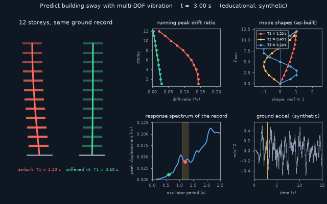
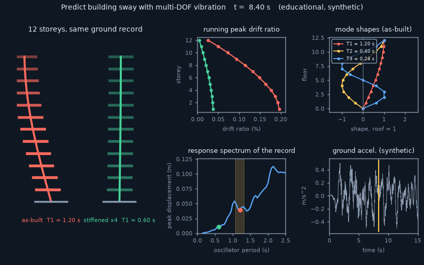
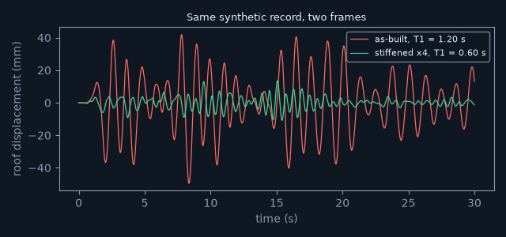
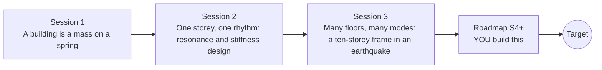

# openbuildingsway

[](https://github.com/KrunalPanchal1995/openbuildingsway/actions/workflows/ci.yml)   [](https://colab.research.google.com/github/KrunalPanchal1995/openbuildingsway/blob/main/sessions/session-01/lesson.ipynb) [](https://krunalpanchal1995.github.io/openbuildingsway/)

**Predict how a building sways in an earthquake, floor by floor.**

openbuildingsway teaches multi-degree-of-freedom vibration, from one mass on a spring to a ten-storey frame shaken by a synthetic earthquake, using only Python and a browser.

- **Start from one spring.** Session 1 needs only school algebra and a square root; every symbol is explained.
- **See it sway.** Every session ships a slider app that runs in the browser, with labelled graphs and a challenge.
- **Trust the numbers.** Mode shapes are checked against an exact formula and two time-domain solvers must agree; the checkpoint prints PASS or FAIL.
- **Build the missing half.** The repo stops at Session 3 on purpose; the roadmap shows the path to the Target.

[Target](#the-target) · [Who is this for](#who-is-this-for) · [Quick start](#quick-start) · [Sessions](#sessions) · [Roadmap](#roadmap) · [Contribute](#contribute) · [Explainer PDF](docs/explainer.pdf)

> **This repo is incomplete on purpose.** Sessions 1 to 3 are here and fully working. The finished Target below is a preview of what the community can build next. We show you the path, not the code. Sessions 4 and up are yours.

## The Target

Two copies of a 12-storey frame are shaken by the same synthetic ground record. The red one has a first period of 1.20 s, right at the dominant period of the shaking; the green one is four times stiffer, with a first period of 0.60 s. Beside them you see the running peak drift in each storey (the red building drifts about 3.4 times more), the response spectrum of the record with both periods marked, the first three mode shapes, and the ground acceleration. Your goal over the coming sessions: build this multi-storey prediction yourself, then extend it.



*Target: a 12-storey frame at resonance (red) and stiffened (green), with drift, spectrum and mode shapes*



*A frame of the Target animation*



*Roof sway of the as-built and the stiffened frame under the same record*

Try it live:

- [Math Visual Studio: eigenvalues and eigenvectors (Atlas S22)](https://krunalpanchal1995.github.io/studio/#atlas?ch=S22&ex=1)
- [Math Visual Studio (Atlas S50, multi-degree-of-freedom systems, has no live example yet)](https://krunalpanchal1995.github.io/studio/)

How the Target was made is shown only as a path in [promo/roadmap.md](promo/roadmap.md).

## Who is this for
**diploma / undergraduate to advanced undergraduate (levels 5-6).** Topic area: Civil Engineering and Construction.

Prerequisites:

- School algebra, square roots and the idea of a sine wave.
- Python 3.10 or newer; if `python --version` works, you are ready. PRIMER.md explains the rest.
- Session 3 uses matrices and eigenvalues; both are explained from scratch, and no prior structural engineering is needed.

New to Python? Read [PRIMER.md](PRIMER.md) first (10 minutes).

## Quick start

No installation knowledge needed. You need [Git](https://git-scm.com/downloads) and [Python 3.10+](https://www.python.org/downloads/) (Windows: tick "Add Python to PATH"). On Mac and Linux type `python3` wherever this page says `python`.

```bash
git clone https://github.com/KrunalPanchal1995/openbuildingsway.git
cd openbuildingsway
python start.py 1
```

`start.py` creates a private environment, installs what is needed and runs Session 1 with its checkpoint. Next: `python start.py 2`, `python start.py 3`, or `python start.py test` to check everything. Only a checkpoint: `python start.py check 1`.

Four lines turn the idea of Session 1 into a result (they work as they are): Save it as `try.py` and run it with `python start.py run try.py` (this uses the private environment, where NumPy is installed):

```python
import numpy as np
m, k = 2.0e5, 2.0e7                              # roof mass (kg) and sideways stiffness (N/m)
T = 2 * np.pi * np.sqrt(m / k)                   # period of the sway
print(f"{T:.3f} s")                              # -> 0.628 s : this building sways once every 0.63 s
```

Every session also opens in your browser with sliders (no install): [live apps](https://krunalpanchal1995.github.io/openbuildingsway/). Or use the Colab badge above for the notebook.

## Sessions

| # | Session | Model level | Time | Live app |
|---|---|---|---|---|
| 1 | [A building is a mass on a spring](sessions/session-01/README.md) | Level 1: conceptual interactive model | 60 min | [open](https://krunalpanchal1995.github.io/openbuildingsway/session-01/) |
| 2 | [One storey, one rhythm: resonance and stiffness design](sessions/session-02/README.md) | Level 2: mathematical engineering model | 75 min | [open](https://krunalpanchal1995.github.io/openbuildingsway/session-02/) |
| 3 | [Many floors, many modes: a ten-storey frame in an earthquake](sessions/session-03/README.md) | Level 3: simulation and validation | 90 min | [open](https://krunalpanchal1995.github.io/openbuildingsway/session-03/) |

Each session follows the same six steps: A real-world problem, B concept and theory, C visual explanation, D interactive simulation, E worked example and experiment, F assessment and design challenge. Each ends with `checkpoint.py`, which prints `PASS` or `FAIL` against reference numbers. Session 3 also contains the real-world mini-project: **Is this 10-storey frame in danger from a 1 s ground period? Fix it by stiffening**.

## Architecture



| Folder or file | What is inside |
|---|---|
| `sessions/` | three sessions: README (A-F), `lesson.py`, notebook, live app, exercises, activity sheet, checkpoint |
| `promo/` | the Target: media, live links, and the roadmap (path only) |
| `docs/` | `explainer.tex` and the built `explainer.pdf` |
| `tests/` | runs every lesson and checkpoint headless |
| `start.py` | one command to set up and run anything |
| `QUALITY.md`, `RUBRIC.md` | the quality checklist and the scoring rubric |
| `.github/` | CI, PDF build, Pages deploy, issue and PR templates |

## Roadmap

| Milestone | What you will build | Difficulty |
|---|---|---|
| Session 4: Response-spectrum shortcut | A function that takes the response spectrum of the record and the modal data of the 10-storey frame and returns a base-shear estimate. | intermediate |
| Session 5: Rayleigh damping instead of modal damping | A damping matrix built from two coefficients that give 5 percent at modes 1 and 3. | intermediate |
| Session 6: Tune the mass damper | A search over damper tuning and damper damping, averaged over six random records. | advanced |
| Session 7: A real record and real periods | A loader for a public ground-motion record, with the dominant period found from its Fourier spectrum. | advanced |
| Session 8: Yielding and torsion | Elastic-perfectly-plastic storeys in the Newmark solver, and a plan-view model with an eccentric mass. | advanced |

Full detail with a checkpoint per milestone: [promo/roadmap.md](promo/roadmap.md).

## Contribute
New to GitHub? Read [CONTRIBUTING.md](CONTRIBUTING.md); it starts from zero. Pick an issue labelled `good first issue`. Translations into Hindi, Telugu, Tamil and Malayalam are welcome.

<details>
<summary>Development</summary>

```bash
python start.py test        # runs every lesson and checkpoint
```
Lessons use `# %%` cell markers so they open as notebooks in VS Code. See [QUALITY.md](QUALITY.md) for the standard every session meets.
</details>

## License
MIT. See [LICENSE](LICENSE). Media in `promo/media` is (c) Krunal Panchal, CC BY 4.0.

## Acknowledgments
Part of the [PAN IIT OSS](https://hellofoss.tech-iitb.org/projects) open-source teaching collection, modelled on the structure of [openspline](https://github.com/openspline/openspline). Built on ideas from the Math Visual Studio at https://krunalpanchal1995.github.io/studio/.
