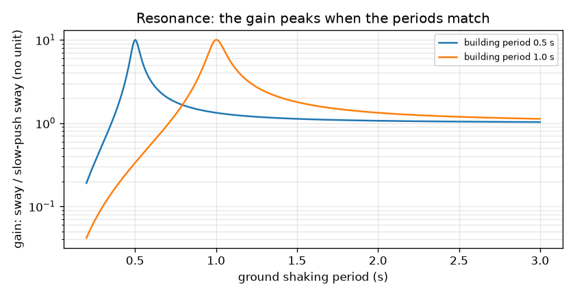
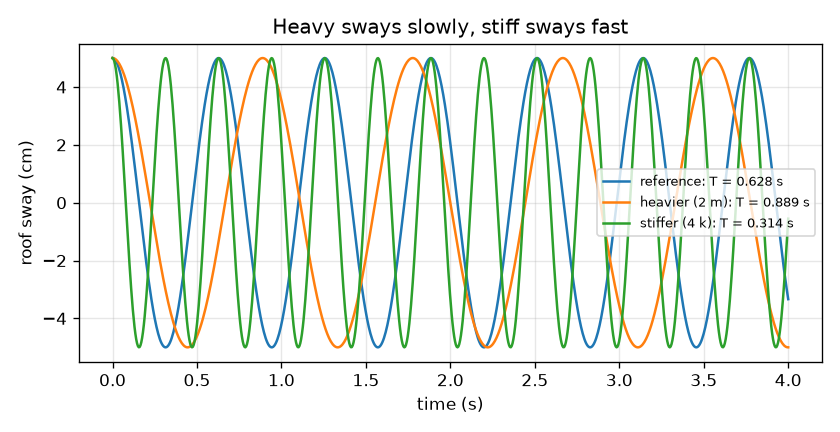

# Session 1: A building is a mass on a spring

*Level 1 (conceptual interactive model) · about 60 minutes · openbuildingsway*

> This is a simplified educational model. It is not a validated design tool and must not be used for real structures, electrical installations, vehicles, industrial processes or medical decisions.

**Prerequisites**

- School algebra and square roots.
- You have read PRIMER.md and run `python start.py 1` once.

**Learning objectives.** After this session you can:

- Explain why a tall building sways back and forth like a pendulum and what sets the time of one sway.
- Use T = 2 pi sqrt(m / k) to find how mass and stiffness change the period.
- Describe resonance: what happens when the ground shaking matches the building's own rhythm.
- Read a graph of gain against ground period.

## A. Real-world problem
After an earthquake some buildings are badly shaken while the one next door hardly moves. Part of the answer is rhythm. Every building has its own slow, regular sway, and the ground has a favourite rhythm too. If the two match, each shove adds to the last, like pushing a child on a swing at just the right moment. What decides a building's rhythm, and how bad is the match? (This repo is for learning. It is a simplified model and must never be used to design or judge a real building.)

## B. Concept and theory
Picture the whole building as one lump of mass m on one spring of stiffness k, where k is the sideways force needed per metre of sway. Pull it sideways and let go: it swings back and forth. The angular frequency w = sqrt(k / m) tells how fast the cycle goes in radians per second, and the period T = 2 pi / w is the time for one full back-and-forth sway. Heavier means slower, stiffer means faster. For typical frame buildings engineers often use the rough empirical rule of thumb T about 0.1 N seconds for N storeys; it is only a guide. When the ground is shaken back and forth with period Tg, the gain says how much the sway is amplified compared with a very slow push. With r = T / Tg and a damping ratio zeta (typically 0.05, meaning the sway dies away by a few percent each cycle), the gain is 1 / sqrt((1 - r^2)^2 + (2 zeta r)^2). Session 2 derives it.

| Symbol | Meaning | Unit |
|---|---|---|
| m | mass of the building lump | kg |
| k | sideways stiffness of the columns | N/m |
| w | angular frequency of the sway | rad/s |
| T | period of the sway | s |
| Tg | period of the ground shaking | s |
| r | ratio T / Tg | no unit |
| zeta | damping ratio | no unit |
| gain | sway divided by the sway for a very slow push | no unit |

**Assumptions**

- The building is one lump on one spring (a single degree of freedom).
- The ground shakes in a steady repeated rhythm, which a real earthquake does not.
- Damping is 5 percent of critical (zeta = 0.05) unless said otherwise.
- Everything stays elastic: nothing cracks or yields.

$$ \omega=\sqrt{\frac{k}{m}},\qquad T=\frac{2\pi}{\omega} $$

$$ x(t)=x_0\cos(\omega t)\quad\text{(free sway released from rest at }x_0\text{)} $$

$$ T\approx 0.1\,N\ \text{s}\quad\text{(rough empirical rule of thumb for typical frame buildings)} $$

$$ \text{gain}=\frac{1}{\sqrt{(1-r^2)^2+(2\zeta r)^2}},\qquad r=\frac{T}{T_g} $$

## C. Visual explanation
The first figure shows three buildings released from the same 5 cm sway: the reference (T = 0.628 s), a heavier one with twice the mass (T = 0.889 s, slower) and a stiffer one with four times the stiffness (T = 0.314 s, twice as fast). The second figure plots the gain against the ground period for buildings with periods of 0.5 s and 1 s on a log scale. Each curve rises to a sharp peak of 10 where the ground period equals the building period, is close to 1 for very slow shaking and falls well below 1 for very fast shaking.

*Gain against ground period for buildings of 0.5 s and 1 s: the peak of 10 sits where the periods match.*

*Three buildings released from the same 5 cm sway: heavy is slow (T = 0.889 s), stiff is fast (T = 0.314 s).*

## D. Interactive simulation
Run the lesson (`python start.py 1`), then open the live app: [Session 1: a building on a spring](https://krunalpanchal1995.github.io/openbuildingsway/session-01/) (or `app.html` in this folder). Drag the mass and stiffness sliders and watch the period in the readout change; then move the ground period and the time slider and see the six-floor building sway. Open the gain graph to see where the peak sits.

**Challenge.** Tune the building to resonate with the 1 s ground: make its period within 2 percent of the ground period.

## E. Worked example and experiment
**Problem.** A building lump has m = 200 000 kg and k = 20 000 000 N/m. Find w and T. What happens to T if the mass doubles, and if the stiffness is multiplied by four? At resonance with 5 percent damping, how much is the sway amplified?

1. w = sqrt(k / m) = sqrt(20 000 000 / 200 000) = sqrt(100) = 10 rad/s.
2. T = 2 pi / w = 6.283 / 10 = 0.6283 s.
3. Double the mass: T grows by a factor sqrt(2), so T = 0.6283 * 1.4142 = 0.8886 s.
4. Four times the stiffness: T shrinks by a factor sqrt(4) = 2, so T = 0.3142 s.
5. At resonance r = 1, so the gain is 1 / sqrt(0 + (2 * 0.05 * 1)^2) = 1 / 0.1 = 10.

**Answer.** w = 10 rad/s and T = 0.6283 s; doubling the mass gives 0.8886 s, quadrupling the stiffness gives 0.3142 s; at resonance the gain is 10.

**Experiment.** Clamp a 30 cm plastic ruler to a desk so that most of it sticks out, and put a lump of modelling clay on the free end. Pull the end sideways, release, and time ten swings with a phone stopwatch to get the period. Add more clay (more mass) and then shorten the free length (stiffer): the period should grow with mass and shrink with stiffness, as in the app. Your numbers will differ from the formula because the ruler has mass of its own, spreads its bending along its length and loses energy to the air and the clamp: the model treats the building as one point mass on a weightless spring.

## F. Assessment and design challenge
**Question type A: Conceptual.** Why does a heavier building sway more slowly while a stiffer building sways faster? Why can a matching ground rhythm be dangerous even when the push itself is small?

Hint

Think of a child on a swing: what changes if the child is heavier? Then think about when a push adds to the motion and when it works against it.

Step-by-step solution

A larger mass is harder to accelerate for the same spring force, so each swing takes longer; a stiffer spring pulls back harder for the same sway, so each swing is quicker. That is T = 2 pi sqrt(m / k). When the ground's period equals the building's, every shove arrives just as the building is already moving the same way, so the effects add up cycle after cycle and only damping limits the sway. Even small pushes can build up to a large sway: at 5 percent damping the gain at resonance is 10.

**Question type B: Numerical.** A building lump has m = 500 000 kg and k = 20 000 000 N/m. Find w and T and say whether it is close to the 1 s ground period.

Hint

w = sqrt(k / m), then T = 2 pi / w. Check the units: k / m is in N/m per kg = 1/s^2.

Step-by-step solution

w = sqrt(20 000 000 / 500 000) = sqrt(40) = 6.325 rad/s. T = 2 pi / 6.325 = 0.9935 s. That is within 1 percent of the 1 s ground period, so this building is almost at resonance and would be strongly amplified (about 10 times). Sanity check: it is heavier than the worked example (200 000 kg, T = 0.628 s), so its period is longer.

**Question type C: Graph and simulation interpretation.** On the gain graph a 1 s building is shaken by a ground whose period is 2 s, and then by one with period 0.5 s. Read the gain in each case and say what each tells an engineer.

Hint

The ratio is r = T / Tg = building period over ground period. Use the formula or read the curve.

Step-by-step solution

With Tg = 2 s, r = 0.5 and the gain is 1.33: the building mostly follows the slow ground motion, a little amplified. With Tg = 0.5 s, r = 2 and the gain is 0.33: the shaking is too quick for the building to follow, so it hardly moves. Both are far from the resonance peak of 10 at Tg = 1 s.

**Question type D: Design and optimisation challenge.** A building has m = 200 000 kg and the ground period is 1 s. Choose a stiffness k that makes its period 0.5 s (a stiff design) or 1.5 s (a flexible design). What does each give for the gain, and what is the downside of each?

Hint

Invert T = 2 pi sqrt(m / k) to get k = m (2 pi / T)^2, then use r = T / Tg in the gain formula.

Step-by-step solution

For T = 0.5 s: k = 200 000 * (2 pi / 0.5)^2 = 3.158e7 N/m, r = 0.5, gain 1.33. For T = 1.5 s: k = 200 000 * (2 pi / 1.5)^2 = 3.509e6 N/m, r = 1.5, gain 0.79. Both avoid the resonance peak of 10. Downsides: the stiff design costs a lot more column material (9 times the stiffness of the flexible one) and attracts larger forces; the flexible design is cheaper but sways a long way in total (a long period means large displacements) and may be uncomfortable or hit the next building. Assumptions: the ground has one steady period and the model is one lump.

Score yourself with [RUBRIC.md](../../RUBRIC.md). Print the [activity sheet](activity_sheet.md) to work on paper.

## Common misconceptions
| Common misconception | What is actually true |
|---|---|
| A stronger building is automatically safer in an earthquake. | Strength and stiffness are different. Stiffness sets the sway period; what matters is how that period sits against the shaking, and how much sway the building can survive. |
| The ground shaking is the same for every building. | The shaking is the same, the response is not: a building amplifies the shaking strongly if its period is close to the ground period and hardly at all if it is far from it. |
| The rule T = 0.1 N seconds is a law of nature. | It is a rough empirical rule for typical frame buildings. Walls, tall slender towers and soft soils can differ a lot, and real periods should be calculated or measured. |
| A heavier building sways more slowly because gravity pulls it down. | The period depends on the mass-to-stiffness ratio. Doubling both the mass and the stiffness leaves the period unchanged. |

## Glossary
- **period**: time for one full back-and-forth sway, in seconds
- **angular frequency**: how fast the sway cycle turns, in radians per second: w = 2 pi / T
- **stiffness**: force needed per metre of sideways sway, in N/m
- **resonance**: large sway that builds up when the shaking rhythm matches the building's own rhythm
- **damping ratio**: fraction of the critical damping; about 0.05 for ordinary buildings
- **gain**: how much a steady shaking is amplified compared with a very slow push

## Finish
1. Do the three coding tasks in [exercises.md](exercises.md).
2. Run `python start.py 1` again after your changes. It ends with the checkpoint; when it prints `PASS`, you are done. (Checkpoint only: `python start.py check 1`.)

Next: [Session 2](../session-02/README.md)
