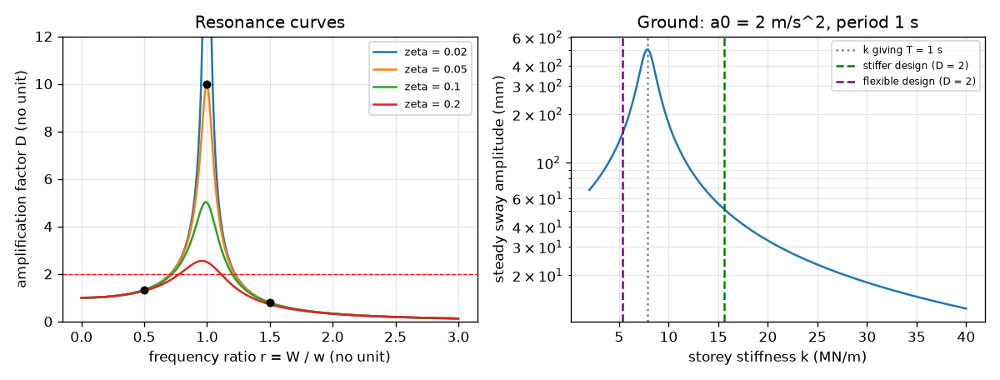

# Session 2: One storey, one rhythm: resonance and stiffness design

*Level 2 (mathematical engineering model) · about 75 minutes · openbuildingsway*

> This is a simplified educational model. It is not a validated design tool and must not be used for real structures, electrical installations, vehicles, industrial processes or medical decisions.

**Prerequisites**

- Session 1: period, stiffness and the idea of resonance.
- Basic graph reading; the formulas are explained in Section B.

**Learning objectives.** After this session you can:

- Write the equation of motion of a single storey shaken at its base and name each term.
- Use the amplification factor D(r) and show that its maximum is about 1 / (2 zeta).
- Check the formula against a step-by-step numerical solution (Runge-Kutta).
- Solve an inverse design problem: how stiff must the storey be to keep D at or below 2?

## A. Real-world problem
Soft soils in many cities shake mostly with a period near 1 s. A one-storey building has a roof mass of 200 tonnes on columns whose stiffness makes its period exactly 1 s. How large does it sway if the ground shakes with an acceleration of 2 m/s^2? And how stiff must the columns be to move the building safely away from that rhythm? (Educational model only, never for real design.)

## B. Concept and theory
Let u be the roof displacement relative to the ground. Newton's law for the roof mass m, with a spring k, a damper c and the ground acceleration a_g(t), gives m u'' + c u' + k u = -m a_g. Dividing by m and writing w = sqrt(k / m) and zeta = c / (2 m w) gives u'' + 2 zeta w u' + w^2 u = -a_g(t). For ground acceleration a0 sin(W t) the sway settles, after a short transient, into a steady wave with amplitude u_max = (a0 / w^2) D(r), where r = W / w is the frequency ratio and D(r) = 1 / sqrt((1 - r^2)^2 + (2 zeta r)^2) is the amplification factor. Since W = 2 pi / Tg and w = 2 pi / T, the ratio is also r = T / Tg. The factor a0 / w^2 is the sway if the acceleration were applied as a constant push. D is largest at r = sqrt(1 - 2 zeta^2) (close to 1) and its maximum is about 1 / (2 zeta); for the typical zeta = 0.05 that is about 10. The rule of thumb T about 0.1 N seconds is a rough empirical guide for N-storey frame buildings.

| Symbol | Meaning | Unit |
|---|---|---|
| m | roof mass | kg |
| k | storey stiffness | N/m |
| c | damping coefficient | N s/m |
| zeta | damping ratio c / (2 m w) | no unit |
| w | natural angular frequency sqrt(k / m) | rad/s |
| T, Tg | natural period of the building, period of the ground shaking | s |
| a0 | amplitude of the ground acceleration | m/s^2 |
| r | frequency ratio W / w = T / Tg | no unit |
| D | amplification factor | no unit |
| u_max | steady sway amplitude relative to the ground | m |

**Assumptions**

- One degree of freedom: the whole building is one roof mass on massless columns.
- The ground motion is a steady sine wave (a real record has many frequencies).
- Damping is viscous with zeta = 0.05 unless said otherwise.
- The structure stays elastic, so a larger shaking gives proportionally larger sway.
- The peak formula needs zeta below 0.7071.

$$ m\ddot u+c\dot u+ku=-m\,a_g(t)\;\Longrightarrow\;\ddot u+2\zeta\omega\dot u+\omega^2u=-a_g(t) $$

$$ \omega=\sqrt{k/m},\quad T=\frac{2\pi}{\omega},\quad \zeta=\frac{c}{2m\omega},\quad r=\frac{\Omega}{\omega}=\frac{T}{T_g} $$

$$ u_{\max}=\frac{a_0}{\omega^2}\,D(r),\qquad D(r)=\frac{1}{\sqrt{(1-r^2)^2+(2\zeta r)^2}} $$

$$ D_{\max}=\frac{1}{2\zeta\sqrt{1-\zeta^2}}\approx\frac{1}{2\zeta}\quad\text{at } r=\sqrt{1-2\zeta^2} $$

$$ k=m\left(\frac{2\pi}{T}\right)^2 $$

## C. Visual explanation
The left figure plots the amplification factor D against the frequency ratio r for four damping ratios (2, 5, 10 and 20 percent), with black dots computed by brute-force numerical integration lying exactly on the 5 percent curve. D starts at 1, climbs to a peak of 25, 10, 5 and 2.5 at r = 1 for the four dampings, and then falls below 1 once r exceeds about 1.41. The right figure plots the steady sway against the storey stiffness for a 200-tonne roof, 2 m/s^2 and a 1 s ground, with the stiff and flexible designs marked: the sway is largest at the stiffness where T = 1 s.

*Left: amplification factor against frequency ratio for four dampings, with numerical dots. Right: steady sway against storey stiffness, with the stiff and flexible design points.*

## D. Interactive simulation
Run the lesson (`python start.py 2`), then open the live app: [Session 2: one storey shaken at its base](https://krunalpanchal1995.github.io/openbuildingsway/session-02/) (or `app.html` in this folder). Change stiffness, mass, damping and ground period, and watch r, D and the sway amplitude in the readout. Use the sway-against-stiffness graph to see how a stiffer or a softer storey moves you off the resonance peak.

**Challenge.** Keep the amplification factor at or below 2 for a 200 t storey on a 1 s ground with 5 percent damping.

## E. Worked example and experiment
**Problem.** A roof mass m = 200 000 kg sits on columns of period T = 1 s. (a) Find k. (b) For a ground acceleration amplitude of 2 m/s^2 and a period of 1 s with zeta = 0.05, find the steady sway. (c) How stiff must the columns be so that D is at most 2 on the stiff side?

1. k = m (2 pi / T)^2 = 200 000 * (6.2832)^2 = 200 000 * 39.478 = 7.896e6 N/m, and w = 2 pi / 1 = 6.283 rad/s.
2. At T = Tg = 1 s, r = 1, so D = 1 / (2 zeta) = 10.
3. a0 / w^2 = 2 / 39.478 = 0.05066 m, so u_max = 0.05066 * 10 = 0.5066 m: more than half a metre.
4. For (c) solve D(r) = 2 with r below 1: (1 - r^2)^2 + (0.1 r)^2 = 0.25. This gives r = 0.7107 (r^2 = 0.505, 1 - r^2 = 0.495, and 0.495^2 + 0.0051 = 0.250).
5. The building period must be T = r Tg = 0.7107 s, so k = m (2 pi / 0.7107)^2 = 1.563e7 N/m, about 1.98 times the original stiffness.

**Answer.** k = 7.896e6 N/m gives resonance with a sway of 0.5066 m for D = 10. Making the columns 1.98 times stiffer (k = 1.563e7 N/m, T = 0.7107 s) brings D down to 2. A much more flexible building also works: D = 2 at r = 1.2186, T = 1.2186 s and k = 5.317e6 N/m (0.673 times the original).

**Experiment.** Hang a mass on a spring from your hand and move your hand up and down slowly, at the spring's own rhythm, and then quickly. At the natural rhythm the mass bounces wildly; much slower it follows your hand; much faster it hardly moves (the three regimes of D). Time the bounces with a phone stopwatch to get T. The experiment will not match 1 / (2 zeta) exactly: a real spring has its own mass, friction and a non-sinusoidal hand motion, and a building also has many modes (Session 3).

## F. Assessment and design challenge
**Question type A: Conceptual.** Why does the amplification factor go above 1 near r = 1 but fall below 1 for large r? What does damping change?

Hint

Think of the three cases: pushing very slowly, at the natural rhythm, and very quickly.

Step-by-step solution

For r near 0 the push is so slow that the building just follows it statically (D = 1). Near r = 1 the push is in step with the building's own swing, so energy is added every cycle and only damping limits the growth, giving D about 1 / (2 zeta). For large r the push reverses before the heavy roof can respond, so the roof hardly moves (D < 1, and D falls as r grows). More damping removes energy faster and lowers the peak: 25, 10, 5 and 2.5 for damping ratios 0.02, 0.05, 0.1 and 0.2; it changes the curve little far from resonance.

**Question type B: Numerical.** A storey has m = 100 000 kg and k = 4e6 N/m, damping 5 percent. The ground has period 1 s and acceleration amplitude 2 m/s^2. Find w, T, r, D and the steady sway amplitude.

Hint

w = sqrt(k / m); r = T / Tg; u_max = (a0 / w^2) D.

Step-by-step solution

w = sqrt(4e6 / 1e5) = sqrt(40) = 6.325 rad/s; T = 2 pi / 6.325 = 0.9935 s; r = 0.9935; D = 1 / sqrt((1 - 0.987)^2 + (0.0994)^2) = 9.98; a0 / w^2 = 2 / 40 = 0.05 m; u_max = 0.05 * 9.98 = 0.499 m. Sanity check: r is almost 1, so D is almost 10 and the sway is almost half a metre. Units: a0 / w^2 is (m/s^2) / (1/s^2) = m.

**Question type C: Graph and simulation interpretation.** On the resonance curves, read D at r = 1 for zeta = 0.02, 0.05, 0.1 and 0.2, and D at r = 1.5 for zeta = 0.05. What does each tell you?

Hint

At r = 1 the formula collapses to 1 / (2 zeta).

Step-by-step solution

At r = 1: D = 25, 10, 5 and 2.5, which is 1 / (2 zeta) in each case. Halving the damping doubles the peak. At r = 1.5 and zeta = 0.05, D = 0.794: the building is shaken faster than its own rhythm and moves less than the static push would.

**Question type D: Design and optimisation challenge.** The ground period is 1.5 s (softer soil) and the roof mass is 200 000 kg. Find the stiffness and the building period for D = 2 on the stiff side and on the flexible side, with the sway amplitude for a0 = 2 m/s^2. Which design would you prefer and why?

Hint

Use r = 0.7107 and r = 1.2186 (from D = 2) with T = r Tg, then k = m (2 pi / T)^2 and u_max = (a0 / w^2) * 2.

Step-by-step solution

Stiff side: T = 0.7107 * 1.5 = 1.066 s, k = 6.948e6 N/m, sway = 0.115 m. Flexible side: T = 1.2186 * 1.5 = 1.828 s, k = 2.363e6 N/m, sway = 0.339 m. Both have D = 2, but the flexible building sways nearly three times further (0.339 against 0.115 m) because a0 / w^2 grows with the period, even though it needs much less stiffness. The stiff design keeps displacements small, which protects partitions and neighbours; it costs more column material and attracts larger forces. The flexible one needs a way to cope with large displacement. Assumptions: steady sine ground motion, one lump, 5 percent damping.

Score yourself with [RUBRIC.md](../../RUBRIC.md). Print the [activity sheet](activity_sheet.md) to work on paper.

## Common misconceptions
| Common misconception | What is actually true |
|---|---|
| The maximum amplification is exactly at r = 1. | For damped systems the peak is at r = sqrt(1 - 2 zeta^2), slightly below 1 (0.9975 for zeta = 0.05); the value there is 10.0125, very close to 1 / (2 zeta) = 10. |
| More damping means less sway at every frequency. | Damping mostly cuts the peak near r = 1; far from resonance the curve hardly changes. |
| Making a building stiffer always makes it safer. | Stiffening moves the period away from the ground period, which can help, but it also changes the forces: the stiffer building attracts larger forces and a record has many frequencies (Session 3). |
| a0 / w^2 is the sway of the building. | It is only the static sway for a constant push. The actual sway is that times the amplification factor D. |

## Glossary
- **equation of motion**: Newton's law written for the roof displacement
- **transient**: the start-up part of the motion that dies away
- **amplification factor**: D, the ratio of the dynamic sway to the sway of a constant push
- **frequency ratio**: r = W / w = T / Tg, shaking rate over natural rate
- **Runge-Kutta**: a step-by-step method to solve differential equations numerically
- **inverse problem**: choosing the inputs (here the stiffness) that give a wanted output

## Finish
1. Do the three coding tasks in [exercises.md](exercises.md).
2. Run `python start.py 2` again after your changes. It ends with the checkpoint; when it prints `PASS`, you are done. (Checkpoint only: `python start.py check 2`.)

Next: [Session 3](../session-03/README.md)
