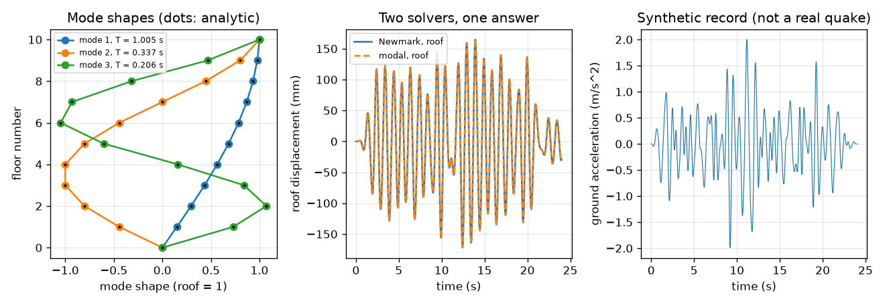
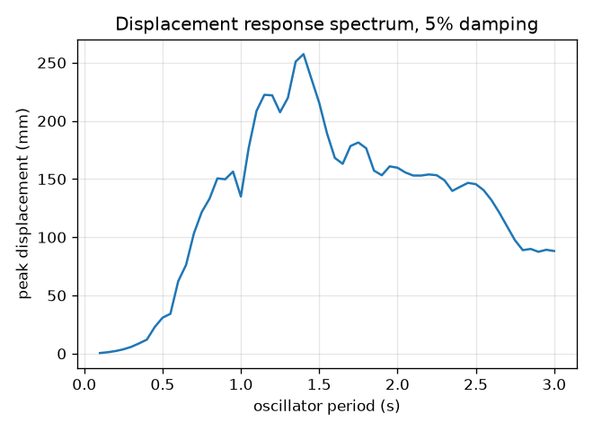
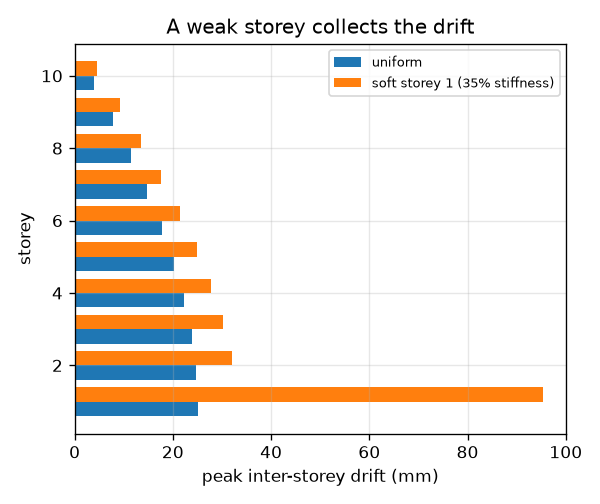

# Session 3: Many floors, many modes: a ten-storey frame in an earthquake

*Level 3 (simulation and validation) · about 90 minutes · openbuildingsway*

> This is a simplified educational model. It is not a validated design tool and must not be used for real structures, electrical installations, vehicles, industrial processes or medical decisions.

**Prerequisites**

- Session 2: equation of motion, amplification factor, damping ratio.
- Matrices as grids of numbers and multiplying them (explained in Section B); eigenvalues are explained from scratch.

**Learning objectives.** After this session you can:

- Build the mass matrix M and the tridiagonal stiffness matrix K of an N-storey shear building.
- Solve K phi = w^2 M phi with np.linalg.eigh and check the periods and mode shapes against an exact formula.
- Compute modal participation and effective mass, and explain why the first mode matters most.
- Solve the response to a synthetic ground record by modal superposition and by Newmark-beta integration, and validate them against each other and against energy.
- Read peak inter-storey drift and base shear, and explain what a soft storey does.

## A. Real-world problem
A real building is not one lump: each floor is a mass, each storey of columns is a spring, and the stack can bend in many patterns at once. For a ten-storey frame with a first period near 1 s, how large is the sway at each floor in a synthetic earthquake record, which storey is bent most, how big is the force at the base, and what happens if one storey is much weaker than the rest? Can we trust the answer? (A simplified, linear, planar model for learning, never for seismic design.)

## B. Concept and theory
Number the floors 1 to N from the bottom; floor 0 is the fixed ground. Let u_j be the sway of floor j relative to the ground, m_j its mass, and k_j the stiffness of storey j, between floors j - 1 and j. The equation of motion is M u'' + C u' + K u = -M r a_g(t), where M is diagonal, K is tridiagonal (each floor feels only its two neighbours) and r is a vector of ones. Free vibration u = phi cos(w t) gives the generalised eigenproblem K phi = w^2 M phi. Because M is diagonal, put phi = M^(-1/2) v to get the ordinary symmetric problem (M^(-1/2) K M^(-1/2)) v = w^2 v, which np.linalg.eigh solves. The columns phi_i are the mode shapes (scaled so phi^T M phi = 1) and w_i the frequencies. For equal masses m and equal storey stiffness k, with a fixed base and a free top, the standard exact result is w_i = 2 sqrt(k / m) sin((2i - 1) pi / (2(2N + 1))) with shape sin((2i - 1) j pi / (2N + 1)) at floor j; we verify it numerically. The ground motion couples to mode i through the participation factor Gamma_i = phi_i^T M r, and the effective modal mass Gamma_i^2 measures how much of the total mass that mode moves; the effective masses of all modes add up to the total mass. Each mode obeys q'' + 2 zeta w q' + w^2 q = -Gamma a_g(t) and u = sum of phi_i q_i (modal superposition). Alternatively the full equation is stepped directly by the Newmark-beta method with the average acceleration parameters beta = 1/4 and gamma = 1/2 (unconditionally stable, no numerical damping). The damping matrix C = M Phi diag(2 zeta w) Phi^T M gives the same zeta in every mode. Design quantities are the inter-storey drift u_j - u_(j-1) (drift ratio = drift / storey height), and the base shear = k_1 u_1, the force in the lowest storey.

| Symbol | Meaning | Unit |
|---|---|---|
| N | number of storeys | no unit |
| m | mass of one floor | kg |
| k | stiffness of one storey | N/m |
| M, K, C | mass, stiffness and damping matrices | kg, N/m, N s/m |
| u | floor sway relative to the ground (vector) | m |
| w_i, phi_i | frequency and mode shape of mode i | rad/s, shape |
| Gamma_i | participation factor of mode i | kg^(1/2) |
| a_g(t) | ground acceleration (synthetic record) | m/s^2 |
| zeta | damping ratio in every mode (0.05) | no unit |
| V | base shear, k1 u1 | N |

**Assumptions**

- Shear building: floors are rigid, all bending is in the storeys (columns), and the base is fixed.
- Planar, linear and elastic: no yielding, cracking, twisting or soil flexibility.
- Classical damping with 5 percent in every mode.
- The ground record is synthetic (made up from seeded random sine waves), not a real earthquake.
- Storey height 3.5 m, floor mass 200 tonnes and storey stiffness 350 MN/m unless said otherwise.

$$ M\ddot{\mathbf u}+C\dot{\mathbf u}+K\mathbf u=-M\mathbf r\,a_g(t) $$

$$ K\boldsymbol\phi=\omega^2M\boldsymbol\phi\;\Longleftrightarrow\;(M^{-1/2}KM^{-1/2})\mathbf v=\omega^2\mathbf v,\quad \boldsymbol\phi=M^{-1/2}\mathbf v $$

$$ \omega_i=2\sqrt{\frac{k}{m}}\sin\frac{(2i-1)\pi}{2(2N+1)},\qquad \phi_{j,i}\propto\sin\frac{(2i-1)j\pi}{2N+1} $$

$$ \Gamma_i=\boldsymbol\phi_i^{\mathsf T}M\mathbf r,\qquad M^*_i=\Gamma_i^2,\qquad \sum_iM^*_i=\mathbf r^{\mathsf T}M\mathbf r $$

$$ \ddot q_i+2\zeta\omega_i\dot q_i+\omega_i^2q_i=-\Gamma_ia_g(t),\qquad \mathbf u=\sum_i\boldsymbol\phi_iq_i $$

$$ \text{Newmark: }\;\dot{\mathbf u}_{n+1}=\dot{\mathbf u}_n+\Delta t[(1-\gamma)\ddot{\mathbf u}_n+\gamma\ddot{\mathbf u}_{n+1}],\ \ \beta=\tfrac14,\ \gamma=\tfrac12 $$

$$ \text{drift}_j=u_j-u_{j-1},\qquad V=k_1u_1 $$

## C. Visual explanation
The first figure has three panels. On the left, the first three mode shapes of the 10-storey frame (periods 1.005 s, 0.337 s and 0.206 s) with black dots from the exact formula lying on the numerical curves. In the middle, the roof sway from the two solvers lying on top of each other. On the right, the synthetic ground acceleration. The second figure compares peak drift per storey in the uniform frame with a frame whose first storey is only 35 percent as stiff: the soft storey takes about 3.8 times the drift. The third figure is the displacement response spectrum of the record: oscillators near 1 s move far more than short-period ones.

*Left: first three mode shapes (dots: exact formula). Middle: roof sway from Newmark and from modal superposition. Right: the synthetic ground record.*

*Displacement response spectrum of the synthetic record for 5 percent damping.*

*Peak inter-storey drift per storey: a soft first storey (35 percent stiffness) concentrates the drift.*

## D. Interactive simulation
Run the lesson (`python start.py 3`), then open the live app: [Session 3: modes of an N-storey shear building](https://krunalpanchal1995.github.io/openbuildingsway/session-03/) (or `app.html` in this folder). Change the number of storeys, mass, stiffness and the strength of the first storey, and pick a mode: watch the mode shape, the period list, the effective mass and the drift profile. The app uses the same maths as the lesson for the mode shapes and periods.

**Challenge.** With 10 storeys, no soft storey and 200 t floors, choose the storey stiffness that puts the first period between 0.4 s and 0.6 s.

## E. Worked example and experiment
**Problem.** Find the periods, mode shapes and effective masses of a two-storey building by hand with m = 200 000 kg and k = 3.5e8 N/m, and check them with the code.

1. K = k [[2, -1], [-1, 1]] and M = m I. With lambda = w^2 m / k the eigenproblem is [[2 - lambda, -1], [-1, 1 - lambda]] phi = 0.
2. The determinant condition (2 - lambda)(1 - lambda) - 1 = lambda^2 - 3 lambda + 1 = 0 gives lambda = (3 -/+ sqrt 5) / 2 = 0.382 and 2.618.
3. k / m = 1750 per s^2, so w1^2 = 0.382 * 1750 = 668.4 and w1 = 25.854 rad/s (T1 = 0.2430 s); w2^2 = 2.618 * 1750 = 4581.6 and w2 = 67.687 rad/s (T2 = 0.0928 s).
4. From the first row, phi2 / phi1 = 2 - lambda: 1.618 for mode 1 (both floors move the same way; this is the golden ratio, the same number as in the Fibonacci example of Atlas S22) and -0.618 for mode 2 (the floors move in opposite directions).
5. Participation for equal masses: Gamma^2 / total mass = (phi1 + phi2)^2 / (2 (phi1^2 + phi2^2)). Mode 1: (2.618)^2 / (2 * 3.618) = 0.947. Mode 2: (0.382)^2 / (2 * 1.382) = 0.0528. They add to 1.

**Answer.** T1 = 0.2430 s with shape (1, 1.618) carrying 94.7 percent of the mass, and T2 = 0.0928 s with shape (1, -0.618) carrying 5.3 percent; the code reproduces all of it. For the 10-storey frame the same code gives T1 = 1.0049 s, T2 = 0.3375 s and T3 = 0.2056 s; the first mode carries 84.8 percent of the mass, the second 9.1 percent and the third 3.1 percent.

**Experiment.** Make a model with a spaghetti tower or a stack of three or four books on a flexible card base: tape coins to each floor, hold the base and shake it sideways by hand while you slowly raise the shaking rate. You will find the first resonance at the lowest rate, with all floors moving the same way, and a second one at a higher rate where the top moves against the middle. Count the shaking rate with a phone video and compare the ratio of the first two frequencies with the model's value (about 3 for a ten-storey frame, 2.6 for two storeys). Expect differences: real floors are not rigid, the base is not fixed, and the damping is not 5 percent.

## Real-world application and mini-project: Is this 10-storey frame in danger from a 1 s ground period? Fix it by stiffening
A 10-storey frame has floors of 200 tonnes, storeys of 350 MN/m each, storey height 3.5 m and 5 percent damping. The city's dominant ground period is 1 s. First show that the frame is in danger: compute its first period and the amplification factor T1 / Tg from Session 2. Then use `peaks` from Session 3 to stiffen every storey by a factor from 1.0 to 4.0 in steps of 0.5. A stiffening passes when the peak roof sway is at most half of the original and the peak inter-storey drift ratio (drift divided by 3.5 m) is at most 0.5 percent.

**Deliverable:** A script that prints, for each factor, the first period, the first-mode amplification factor, the peak roof displacement, the drift ratio and the base shear, names the smallest passing factor, and saves a plot of roof sway against stiffness factor. Add two sentences on the trade-off you see in the base shear.

**Success looks like:** The smallest passing factor is reported as 3.0 (the original fails): with it T1 = 0.580 s, the roof sway falls from 172 mm to 63 mm and the drift ratio is 0.28 percent. Your write-up notes that the base shear rises from 8.77 MN to 10.37 MN, so stiffening trades sway for force.

## F. Assessment and design challenge
**Question type A: Conceptual.** Why does the first mode carry most of the mass in the response, and why does the second mode have a node (a floor that hardly moves)?

Hint

Look at the mode shapes: in which mode do all floors move the same way? Then look at the effective masses.

Step-by-step solution

In mode 1 all floors move in the same direction, so the ground pushes all of them in step: the participation Gamma = phi^T M r is largest, and 84.8 percent of the mass (10 storeys) takes part. In mode 2 the top moves against the middle: pushes on the two groups of floors partly cancel and only 9.1 percent takes part. Mode 2 changes sign once along the height, so one floor sits near a node. Higher modes have more sign changes and less mass. That is why a handful of modes (here three, 97 percent) is enough.

**Question type B: Numerical.** Two storeys with m = 100 000 kg and k = 1e8 N/m: find both frequencies and periods by hand, then say which mode is more dangerous for a ground period of 1 s.

Hint

w^2 = lambda k / m with lambda = (3 -/+ sqrt 5) / 2, so k / m = 1000 per s^2.

Step-by-step solution

w1^2 = 0.382 * 1000 = 381.97 so w1 = 19.544 rad/s and T1 = 0.3215 s; w2^2 = 2.618 * 1000 = 2618.0 so w2 = 51.167 rad/s and T2 = 0.1228 s. Both periods are far shorter than 1 s, so the ratio T / Tg is below 0.33 for both and neither is near resonance; mode 1 (0.3215 s) is the closer one. Units: k / m is 1/s^2, w is in rad/s.

**Question type C: Graph and simulation interpretation.** In the soft-storey bar chart, which storey carries the largest drift and how much more than in the uniform frame? What does the damage tell an engineer?

Hint

Compare the two bars in storey 1 and also look at the rest of the storeys.

Step-by-step solution

Storey 1: 95.3 mm with a soft first storey against 25.1 mm in the uniform frame, 3.8 times as much, as drift ratio 2.7 percent against 0.72 percent. The other storeys stay near their normal drift. The weak storey concentrates the bending: the whole building above it moves with it, so the first-storey columns take the damage. This is the typical failure of buildings with an open ground floor.

**Question type D: Design and optimisation challenge.** Design: the first storey is weaker than the others by a factor f (between 0.35 and 1). Find the smallest f in steps of 0.1 that keeps the first-storey drift at no more than 1.5 times the largest drift of the other storeys. Justify the trade-off.

Hint

Use `soft_storey_stiffness(factor=f)`, run Newmark and compare the first drift with the maximum of the others.

Step-by-step solution

At f = 0.6 the first-storey drift is 55.4 mm, 1.71 times the largest other drift: fails. At f = 0.7 it is 43.5 mm, 1.46 times: passes. So f = 0.7 (the first storey at least 70 percent as stiff as the others) is the smallest with margin; f = 0.35 gives 2.97 times. Trade-off: stiffening the ground floor costs structure and may attract more force; f = 1 gives 1.01 times, a uniform drift. Assumptions: this one synthetic record, linear behaviour, uniform masses.

Score yourself with [RUBRIC.md](../../RUBRIC.md). Print the [activity sheet](activity_sheet.md) to work on paper.

## Common misconceptions
| Common misconception | What is actually true |
|---|---|
| A building has one natural period. | An N-storey building has N periods, one for each mode shape; the first (longest) one matters most for sway, but higher modes matter for forces on the upper floors. |
| Two correct solvers will give identical numbers. | They agree within the numerical error of each: here modal superposition and Newmark differ by 0.41 percent of the peak, because Newmark with a finite time step slightly stretches periods. Halving the time step changes the Newmark answer by 0.31 percent. |
| The roof has the largest drift. | Drift is the difference between neighbouring floors. In the uniform frame the first storey has the largest drift (25.1 mm) and the top storey the smallest (3.9 mm), even though the roof moves the most. |
| Stiffening always reduces the force. | A stiffer building moves less but attracts larger forces: stiffening by a factor of 3 raises the base shear of the example from 8.77 MN to 10.37 MN while the roof sway falls from 172 mm to 63 mm. |

## Glossary
- **degree of freedom**: one independent way a structure can move; here one per floor
- **mode shape**: the pattern of floor displacements in one natural vibration
- **eigenvalue problem**: finding the numbers w^2 and vectors phi with K phi = w^2 M phi
- **participation factor**: how strongly the ground shaking drives a mode
- **effective modal mass**: the part of the total mass that a mode moves; all add up to the total
- **inter-storey drift**: relative sway between two neighbouring floors
- **base shear**: total sideways force carried by the foundation
- **Newmark-beta**: a step-by-step method for the full equations; beta = 1/4, gamma = 1/2 is the average acceleration form
- **soft storey**: a storey much less stiff than its neighbours

## Finish
1. Do the three coding tasks in [exercises.md](exercises.md).
2. Run `python start.py 3` again after your changes. It ends with the checkpoint; when it prints `PASS`, you are done. (Checkpoint only: `python start.py check 3`.)

Next: the [roadmap](../../promo/roadmap.md). Session 4 is yours to build.
